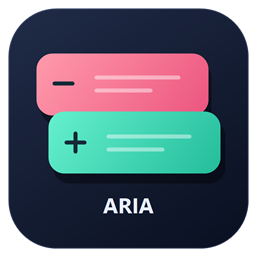
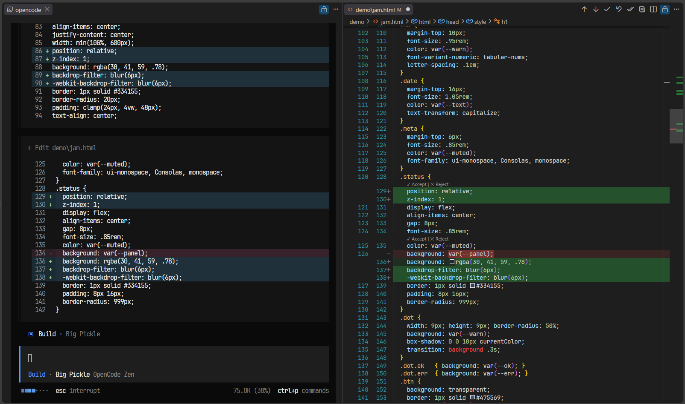
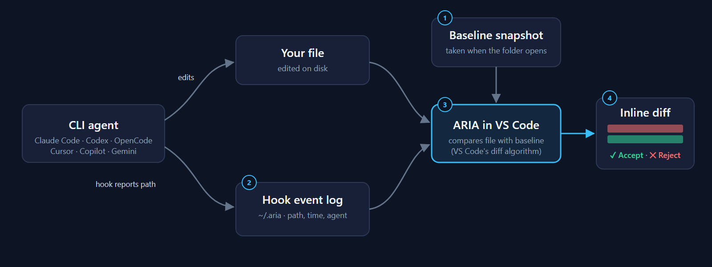

<p align="center">
  
</p>

<h1 align="center">ARIA</h1>

<p align="center">
  <strong>A Review Inline Agent</strong><br>
  Review every edit your terminal AI agent makes, inline in VS Code, and keep only what you accept.
</p>

<p align="center">
  <a href="https://marketplace.visualstudio.com/items?itemName=krispachi.aria-review"></a>
  <a href="https://marketplace.visualstudio.com/items?itemName=krispachi.aria-review"></a>
  <a href="https://open-vsx.org/extension/krispachi/aria-review"></a>
  <a href="https://open-vsx.org/extension/krispachi/aria-review"></a>
  <a href="https://github.com/krispachi/aria/releases/latest"></a>
  <br>
  
  
  
  
</p>

<p align="center">
  
</p>

---

## What is ARIA?

**ARIA = A Review Inline Agent.** It is the reviewer that sits between a CLI coding agent and your code:

- **A**: one extension for many agents (OpenCode, Claude Code, Codex CLI, Cursor CLI, GitHub Copilot CLI, Gemini CLI).
- **Review**: nothing an agent writes is final until you decide.
- **Inline**: changes appear directly in the file as red (old) and green (new) rows, the way editor-based assistants show them.
- **Agent**: built for agents that run in a terminal and edit files on disk, which normally bypass any review UI.

Terminal agents write straight to your files. ARIA notices each edit, opens the file as an inline diff and lets you **Accept** or **Reject** each change group, a whole file, or everything at once. You can also edit the proposed code directly before deciding. It works without Git.

## How it works

<p align="center">
  
</p>

1. When a folder opens, ARIA takes a **baseline snapshot** of your text files (in memory, nothing written to the project).
2. A small **user-level hook** in each CLI reports which file the agent just edited. Hooks live in your home folder, never in the project.
3. ARIA compares the file with its baseline using **VS Code's own diff algorithm** and opens an inline diff on the changed lines.
4. **Accept** keeps the new code; **Reject** restores the old code. Accepted code becomes the new baseline.

## Features

| | |
|---|---|
| **Inline review** | Red/green rows in the real file, editable before you decide. |
| **Decide at any level** | Accept/Reject per change group, per file, or for all pending files. |
| **Buttons where you want them** | File and all-files buttons in the status bar (default), the editor toolbar, both, or hidden. |
| **Navigation** | Previous/Next across files, position counter (e.g. `2/7`) and an **ARIA Changes** view in the Explorer. |
| **Per-agent switches** | Turn review off for one agent (for example when it already has its own review extension) without touching the others. |
| **Safe by design** | Guarded Undo, conflict checks before overwriting, unsaved manual edits are never discarded. |
| **Survives restarts** | Pending reviews and Undo history can be restored when you reopen the workspace. |
| **Private** | No AI calls, no uploads, no telemetry. Everything stays on your machine. |

<!--  -->
<!--  -->

## Supported agents

| Agent | Hook location | Status |
|---|---|---|
| OpenCode | global plugin in `~/.config/opencode/plugins/` | ✅ Tested in real sessions |
| Claude Code | PostToolUse hook in `~/.claude/settings.json` | ✅ Tested in real sessions |
| Codex CLI | PostToolUse hook in `~/.codex/config.toml` (trust it with `/hooks`) | ✅ Tested in real sessions |
| Cursor CLI | afterFileEdit hook in `~/.cursor/hooks.json` | ✅ Tested in real sessions |
| GitHub Copilot CLI | hook file in `~/.copilot/hooks/` | 🧪 Adapter included, not yet verified |
| Gemini CLI | AfterTool hook in `~/.gemini/settings.json` | 🧪 Adapter included, not yet verified |

Existing hooks in those files are preserved, and a backup is made before any change. Hook formats change between CLI versions: if an agent's edits do not appear, run **ARIA Review: Agent Adapter Status** and [open an issue](https://github.com/krispachi/aria/issues/new/choose).

## Quick start

1. **Install** ARIA and open a **trusted** folder. Review starts automatically and the agent hooks are installed at user level; no command is needed.
2. **Restart your CLI agent** and approve its hook trust prompt if it asks (Codex: run `/hooks`).
3. **Ask the agent to edit a file.** ARIA opens a review tab without taking keyboard focus or navigating to the edit. Already-open saved files reload through VS Code first, then convert directly to a diff before being marked pending. Existing cursor selection is preserved. Unsaved plain source tabs stay in place to avoid a Save/Discard prompt; use Next/Previous Change to open their diff explicitly.
4. **Decide**: click **✓ Accept** / **✕ Reject** above a change group, or use **Accept File**, **Reject File**, **Accept All**, **Reject All** in the status bar.

Saving a file does **not** accept its pending changes. When the last change in a file is decided, the tab returns to a normal editor.

If an agent's edits do not show up, run **ARIA Review: Agent Adapter Status**. ARIA reinstalls missing hooks on its next start; **ARIA Review: Install Agent Adapters (user-level)** does it immediately. Restart the CLI afterward.

## Controls at a glance

| Where | What you get |
|---|---|
| Above each change group | **✓ Accept** · **✕ Reject** |
| Status bar (bottom) | `2/7` position, ↑ ↓ Previous/Next, **Accept File** · **Reject File** · **Accept All** · **Reject All** |
| Explorer → **ARIA Changes** | Every pending file and group, with Accept/Reject and Undo |
| Explorer badge | **M** on files that still have pending review |
| Command Palette (`Ctrl+Shift+P`) | Every command below |

**Button position for change groups.** VS Code always draws removed (red) rows directly above the line that carries the buttons, so the buttons cannot touch the red rows. `aria.blockActionsAnchor` offers two layouts:

| `beforeGroup` (default) | `firstChangedRow` |
|---|---|
| Buttons → one unchanged line → red → green | Red → buttons → green |

Added-only groups always have the buttons directly above the green rows.

## Commands

All commands start with **ARIA Review:** in the Command Palette.

| Task | Commands |
|---|---|
| Decide | Accept File, Reject File, Accept All Files, Reject All Files, Accept Current Change, Reject Current Change, Undo Last Decision |
| Navigate | Next Change, Previous Change, Choose Pending Change, Open Changes |
| Customize | **Quick Settings**, Settings, **Choose Agents**, **Choose Button Location**, Configure Keyboard Shortcuts, Toggle Auto Open, Toggle Auto Advance |
| On / off | Enable, Disable (this directory), Enable All Directories, Disable All Directories, Init Directory, Start Session, Stop Session |
| Agent hooks | Install Agent Adapters (user-level), Agent Adapter Status, Remove Agent Adapters |
| Data | Export Settings, Import Settings, Recover Saved Review, Clear Saved Review, Clean Extension Data |

ARIA reserves no default keyboard shortcuts. Use **Configure Keyboard Shortcuts** to bind any of them.

## Settings

Open **ARIA Review: Settings** (or search `ARIA` in Settings). Settings are grouped into categories so they are easy to find; **Quick Settings** covers the most common ones in one list.

<!--  -->

| Category | Settings |
|---|---|
| **General** | `aria.enabled` (master switch), `aria.activationMode` (`all` folders or only `init`ialized ones), `aria.autoStart`, `aria.track` (`agent` or diagnostic `all`), `aria.notifications` (`once`, `minimal`, `full`) |
| **Agents and Hooks** | `aria.agents.<agent>.enabled` for `opencode`, `claude`, `codex`, `cursor`, `copilot`, `gemini`; `aria.adapterSetup` (`auto`, `ask`, `off`); `aria.eventsFile` |
| **Buttons and Display** | `aria.fileActionsLocation`, `aria.allActionsLocation` (`statusBar`, `editorToolbar`, `both`, `hidden`); `aria.showBlockActions`; `aria.blockActionsAnchor`; `aria.showPosition`; `aria.showChangesView`; `aria.showPendingBadge` |
| **Review Flow** | `aria.autoOpen`, `aria.autoAdvance`, `aria.autoUnfold`, `aria.restoreOnReopen`, `aria.autoSaveResolved` |
| **Saved Review and Undo** | `aria.persistReview`, `aria.retentionDays` (default 7), `aria.undoLimit` (default 20) |
| **Performance and Privacy** | `aria.maxFileSizeKb` (default 1024), `aria.maxSnapshotSizeMb` (default 64), `aria.excludePatterns` (defaults exclude `.env`, `.env.*`, `*.pem`, `*.key`) |
| **Deprecated** | Older `opencodeInlineReview.*`, `agentInlineReview.*` and replaced toggles, kept so old settings and exports still work |

ARIA also sets a few VS Code defaults so the review looks right: inline (not side-by-side) diffs, CodeLens in diffs, whitespace-sensitive comparison and softer red/green diff colors. Your own settings always win.

Diff line backgrounds use approximately 14% opacity; character highlights use approximately 18%. If external reload is disabled or takes longer than three seconds, ARIA leaves a clean buffer untouched and logs the deferred review in Output; reopen the source to load its disk changes.

## Turning ARIA or one agent off

- **Disable All Directories** / **Enable All Directories**: global switch. Your directory and agent choices are kept.
- **Disable** / **Enable**: only the current directory.
- **Choose Agents**: check or uncheck each agent. Example: turn Claude Code off if you use a Claude-specific review extension. The hook stays installed but its events are ignored, so you can turn it back on at any time.

What happens to edits made while something is off:

- **While ARIA is disabled** (globally, for the directory, or with every agent off), edits are not recorded. Enabling ARIA takes a fresh baseline and skips everything that happened in between.
- **From a disabled agent**, edits are never reviewed. ARIA moves that file's baseline to the new content, so a later edit by an enabled agent shows only its own changes. If the file is already under review for another agent, the mixed change stays visible rather than being silently accepted.

## Privacy and local data

- ARIA does not call AI models, upload code, or send telemetry.
- Hook events contain only file paths, timestamps and agent IDs, stored in `~/.aria/projects/`.
- Pending snapshots and Undo history are stored as **local plaintext** in VS Code's workspace extension storage (outside the project, not synced). Turn off `aria.persistReview` for memory-only review, and use `aria.excludePatterns` for sensitive files.
- **Clean Extension Data** removes ARIA settings, hooks, runtime files and this workspace's saved review. Uninstalling removes ARIA's hooks automatically, after VS Code restarts.

<details>
<summary><strong>Limitations</strong></summary>

- Edits made by shell commands without a reported path are not attributed to an agent. Use **Mark Active File as Agent Change** or the diagnostic `aria.track: all` mode.
- Deleted files are not shown as review documents.
- Deleted temporary files are removed from pending review without recreating them. Accept All leaves closed tabs closed; automatic dirty-buffer clearing only applies to files whose tabs are still open. The legacy `aria.preserveTerminalFocus` setting is retained for import compatibility; automatic opening now always preserves focus.
- Buttons cannot sit directly above removed (red) rows; see `aria.blockActionsAnchor` above.
- Files larger than `aria.maxFileSizeKb`, binary files and files over the snapshot budget are skipped.
- Unsaved buffers rely on VS Code's own backups; ARIA restores review snapshots, not editor contents.
- If ARIA is stopped mid-review, files it marked as unsaved keep the unsaved dot until you revert or save them.
- Workspace Trust is required. Virtual workspaces are not supported.

</details>

<details>
<summary><strong>Undo, restarts and recovery</strong></summary>

- **Undo Last Decision** reverts the last Accept/Reject, including file-wide or all-files decisions. It refuses if the file changed afterward, so later edits are never overwritten.
- When the workspace reopens, files whose content still matches resume their review. Files that changed while closed keep their snapshot separately; **Recover Saved Review** compares one with the current file.
- If Save fails after a Reject, the rejected result stays unsaved in the editor; ARIA never forces Overwrite.

</details>

<details>
<summary><strong>Export, import and uninstall</strong></summary>

- **Export Settings** writes a versioned JSON file of ARIA preferences, optionally with directory choices. No source code, review history or hooks are exported.
- **Import Settings** validates the whole file first, lets you choose User or Workspace settings, and rolls back if an update fails.
- Uninstalling removes identifiable ARIA hooks and event files and keeps your configuration backups. Run **Clean Extension Data** first for a complete removal.

</details>

<details>
<summary><strong>Resource use</strong></summary>

Snapshots read at most eight files at a time and respect per-file and total size limits. Diff results are cached until content changes, and closed diff models are released. Very large or very different files are reviewed as one group instead of blocking the editor. Details of skipped files are written to **Output → ARIA Review**.

</details>

## Development

```bash
npm ci
npm test          # compile + unit tests (VS Code API mocks, real adapter runtimes)
npm run package   # builds ../builds/krispachi-aria-review-<version>.vsix
```

`npm run test:extension` runs an extension-host smoke test on Windows. See [CONTRIBUTING.md](CONTRIBUTING.md) for the project layout and how to add an agent adapter, and [CHANGELOG.md](CHANGELOG.md) for release notes.

## License

[MIT](LICENSE) © Krispachi
